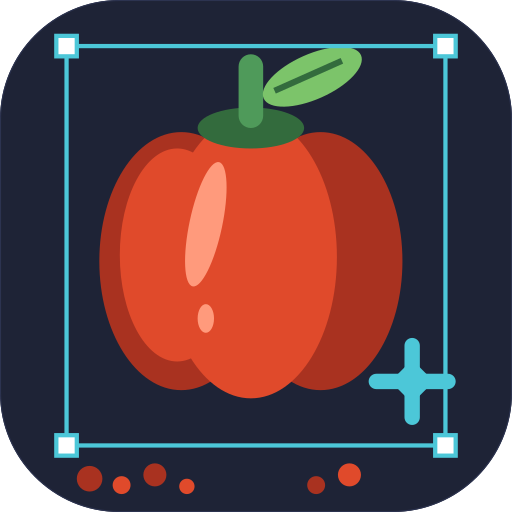
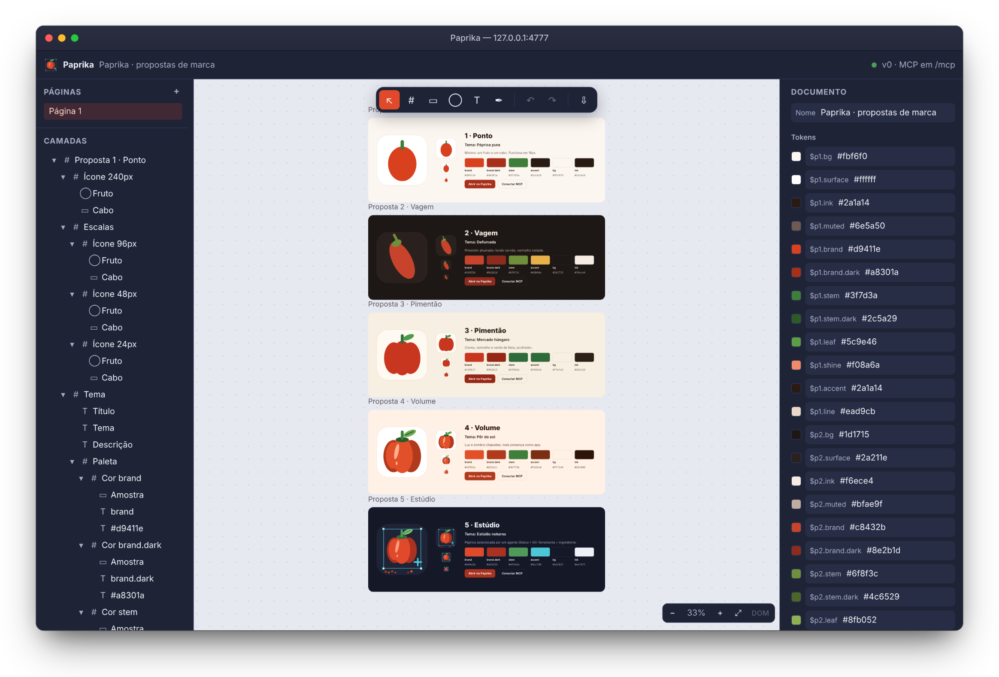

🇺🇸 English | [🇧🇷 Português](README.pt-BR.md)

<p align="center"></p>

<p align="center"></p>

# Paprika

**A design tool where you and your AI agent draw together.**

You open a canvas in your browser. Your agent (Claude Code, or any other agent that speaks [MCP](https://modelcontextprotocol.io)) gets its own set of tools to create screens, components and diagrams on that same canvas. You watch its cursor move while it works, fix things by hand whenever you like, and undo anything either of you did.

Everything runs on your own computer. There is no account to create, no usage limit and no cloud service holding your designs.

## Why you might like it

- **Your agent can design, not only write code.** Ask for a login screen, a flowchart or a set of icons and see it appear.
- **You stay in control.** You see what the agent is touching as it happens, and you share one undo history, so nothing is lost.
- **The agent checks its own work.** It can take screenshots and run checks for color contrast, text that doesn't fit and missing design tokens before it tells you it's done.
- **From design to code.** A design can be exported as HTML, a React component or SVG.
- **It stays yours.** Designs live in a local database and can be exported to a plain file you can keep in git.

## Get started

You need [Docker](https://docs.docker.com/get-docker/). Then, in a terminal:

```bash
git clone https://github.com/leonardo-moraes360/paprika.git
cd paprika
docker compose up -d --build
```

The first build takes a few minutes. When it finishes:

1. Open **http://localhost:4777** in your browser. You'll see your workspaces; double-click one to open its canvas.
2. Connect your agent to **http://localhost:4777/mcp**. With Claude Code:

   ```bash
   claude mcp add --transport http paprika http://localhost:4777/mcp
   ```

   Other agents: add an MCP server of type "HTTP" (sometimes called "streamable HTTP") with that address.
3. Ask your agent for something, like *"Use Paprika to design a sign-up screen for a coffee shop app."*

Your designs are kept in a Docker volume, so they survive restarts. `docker compose down` stops Paprika; `docker compose up -d` starts it again.

Prefer not to use Docker? See [running from source](docs/development.md#run-from-source).

### Or let your agent set it up

Copy this prompt into your agent (it works best in one that can run terminal commands, such as Claude Code):

```text
Please set up Paprika for me, a local design tool for AI agents
(https://github.com/leonardo-moraes360/paprika).

1. Check that Docker and Docker Compose are installed and running. If they
   aren't, stop and tell me how to install them; don't install anything
   without asking me first.
2. Clone the repository into a folder of my choice (ask me; default to
   ~/paprika) and run `docker compose up -d --build` inside it. The first
   build can take a few minutes.
3. Wait until http://localhost:4777/api/workspaces answers, then tell me to
   open http://localhost:4777 in my browser.
4. Add Paprika to yourself as an MCP server over HTTP at
   http://localhost:4777/mcp. In Claude Code:
   claude mcp add --transport http paprika http://localhost:4777/mcp
   If you need a restart or a new session to see the new tools, tell me.
5. Once the tools show up, call `get_design_guide`, then draw a small welcome
   frame on the canvas so I can see it working.

If something fails, show me the error and what you'd suggest. Keep host port
4777: the server only accepts that port.
```

## What you can do

- Organize designs into **workspaces**, each with its own pages and a cover on the overview.
- Draw frames, shapes, text, images and free **vector paths** with the pen tool.
- Build **components** and reuse them as instances; switch **light and dark themes** with design tokens.
- Make **diagrams**: boxes, decisions, sticky notes and arrows that follow the shapes.
- Paste SVG or HTML from anywhere and get editable layers; download the result as SVG.
- See **every connected agent** on the canvas with its own cursor, name and color.

The full list of tools and shortcuts is in [Using the canvas](docs/canvas.md).

## Learn more

| If you want to… | Read |
|---|---|
| Learn the canvas, shortcuts and diagrams | [Using the canvas](docs/canvas.md) |
| Connect an agent, see every MCP tool and the file format | [Agents and MCP](docs/mcp.md) |
| Run with Docker: import, export, backups, ports | [Docker](docs/docker.md) |
| Build from source, run the tests, contribute code | [Development](docs/development.md) · [CI](docs/ci.md) |
| Understand how it is built | [Architecture](docs/architecture.md) · [Go server](server-go/README.md) · [Decisions (ADRs)](docs/adr/) |
| See what's planned | [Backlog](docs/backlog.md) |

## Good to know

- Paprika listens only on your own machine (`localhost`) and has **no login**. Don't expose it to a network you don't trust.
- Taking screenshots and exporting SVG use a headless Chrome, which the Docker image already includes.
- Found a security problem? Please report it privately, as described in [SECURITY.md](SECURITY.md), not in a public issue.

## Contributing

Ideas, bug reports and pull requests are welcome. Start with [CONTRIBUTING.md](CONTRIBUTING.md); everyone taking part follows the [Code of Conduct](CODE_OF_CONDUCT.md).

Paprika is an original project. Paper (paper.design) was only a conceptual reference ("an HTML/CSS canvas connected to agents"); no code, assets or behavior were copied or reverse-engineered.

## License

[MIT](LICENSE)
