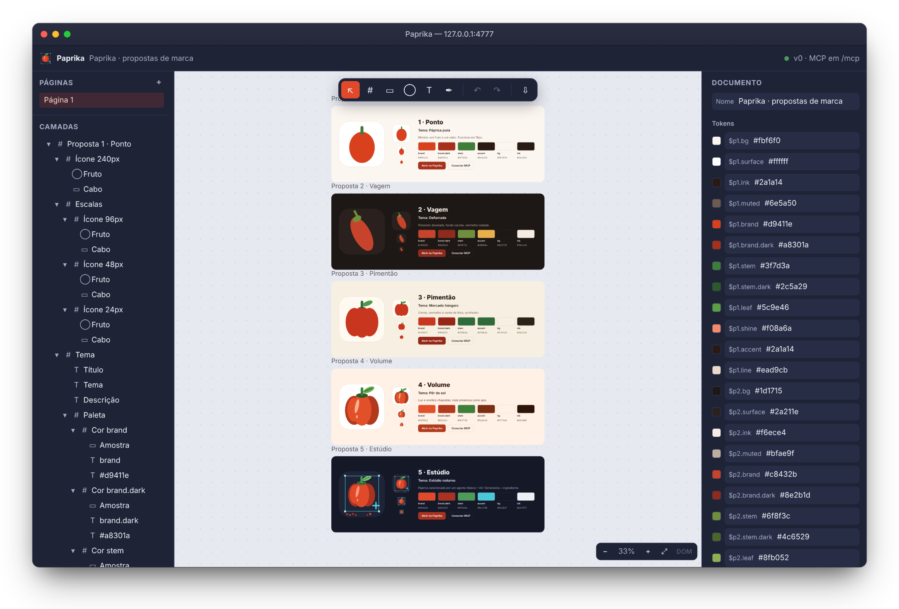

[🇺🇸 English](README.md) | 🇧🇷 Português

<p align="center"></p>

<p align="center"></p>

# Paprika

**Uma ferramenta de design em que você e o seu agente de IA desenham juntos.**

Você abre um canvas no navegador. O seu agente (o Claude Code, ou qualquer outro agente que fale [MCP](https://modelcontextprotocol.io)) ganha um conjunto de ferramentas próprio para criar telas, componentes e diagramas nesse mesmo canvas. Você vê o cursor dele se mexendo enquanto ele trabalha, ajusta o que quiser com as próprias mãos e desfaz qualquer coisa que um dos dois tenha feito.

Tudo roda no seu computador. Não tem conta para criar, não tem limite de uso e nenhum serviço na nuvem guarda os seus designs.

## Por que você pode gostar

- **O seu agente desenha, não só escreve código.** Peça uma tela de login, um fluxograma ou um conjunto de ícones e veja aparecer.
- **Você continua no controle.** Você vê o que o agente está mexendo na hora, e os dois compartilham o mesmo histórico de desfazer, então nada se perde.
- **O agente confere o próprio trabalho.** Ele tira screenshots e verifica contraste de cores, texto que não cabe e tokens de design faltando antes de dizer que terminou.
- **Do design ao código.** Um design pode ser exportado como HTML, componente React ou SVG.
- **Continua sendo seu.** Os designs ficam num banco de dados local e podem ser exportados para um arquivo simples que você guarda no git.

## Começando

Você precisa do [Docker](https://docs.docker.com/get-docker/). Depois, num terminal:

```bash
git clone https://github.com/leonardo-moraes360/paprika.git
cd paprika
docker compose up -d --build
```

O primeiro build leva alguns minutos. Quando terminar:

1. Abra **http://localhost:4777** no navegador. Você verá os seus workspaces; dê um clique duplo num deles para abrir o canvas.
2. Conecte o seu agente em **http://localhost:4777/mcp**. No Claude Code:

   ```bash
   claude mcp add --transport http paprika http://localhost:4777/mcp
   ```

   Outros agentes: adicione um servidor MCP do tipo "HTTP" (às vezes chamado de "streamable HTTP") com esse endereço.
3. Peça alguma coisa ao agente, como *"Use o Paprika para desenhar uma tela de cadastro para o app de uma cafeteria."*

Os designs ficam guardados num volume do Docker e sobrevivem a reinícios. `docker compose down` para o Paprika; `docker compose up -d` sobe de novo.

Prefere não usar Docker? Veja [como rodar sem Docker](docs/pt-BR/desenvolvimento.md#rodar-sem-docker).

### Ou deixe o seu agente fazer o setup

Cole este prompt no seu agente (funciona melhor num que consiga rodar comandos no terminal, como o Claude Code):

```text
Por favor, configure o Paprika para mim, uma ferramenta de design local para
agentes de IA (https://github.com/leonardo-moraes360/paprika).

1. Confira se o Docker e o Docker Compose estão instalados e rodando. Se não
   estiverem, pare e me diga como instalar; não instale nada sem me perguntar
   antes.
2. Clone o repositório numa pasta que eu escolher (me pergunte; o padrão é
   ~/paprika) e rode `docker compose up -d --build` dentro dela. O primeiro
   build pode levar alguns minutos.
3. Espere até http://localhost:4777/api/workspaces responder e então me diga
   para abrir http://localhost:4777 no navegador.
4. Adicione o Paprika a você mesmo como servidor MCP por HTTP em
   http://localhost:4777/mcp. No Claude Code:
   claude mcp add --transport http paprika http://localhost:4777/mcp
   Se precisar reiniciar ou abrir uma sessão nova para ver as ferramentas,
   me avise.
5. Quando as ferramentas aparecerem, chame `get_design_guide` com
   `language: "pt-BR"` e desenhe um pequeno frame de boas-vindas no canvas
   para eu ver funcionando.

Se algo falhar, me mostre o erro e o que você sugere. Mantenha a porta 4777 no
host: o servidor só aceita essa porta.
```

## O que dá para fazer

- Organizar os designs em **workspaces**, cada um com as próprias páginas e uma capa na tela inicial.
- Desenhar frames, formas, texto, imagens e **vetores livres** com a caneta.
- Criar **componentes** e reutilizá-los como instâncias; trocar entre **tema claro e escuro** com tokens de design.
- Fazer **diagramas**: caixas, decisões, notas adesivas e setas que acompanham as formas.
- Colar SVG ou HTML de qualquer lugar e receber camadas editáveis; baixar o resultado em SVG.
- Ver **cada agente conectado** no canvas, com cursor, nome e cor próprios.
- Trabalhar **em time sem servidor**: `paprika serve --team` conecta o Paprika e os agentes de cada pessoa peer to peer (Iroh + CRDT Loro), com convite por link ou QR e só as chaves do time aceitas ([Sincronização de time](docs/pt-BR/sincronizacao-time.md)).

A lista completa de ferramentas e atalhos está em [Usando o canvas](docs/pt-BR/canvas.md).

## Para saber mais

| Se você quer… | Leia |
|---|---|
| Aprender o canvas, os atalhos e os diagramas | [Usando o canvas](docs/pt-BR/canvas.md) |
| Conectar um agente, ver todas as ferramentas MCP e o formato do arquivo | [Agentes e MCP](docs/pt-BR/mcp.md) |
| Rodar com Docker: importar, exportar, backup, portas | [Docker](docs/pt-BR/docker.md) |
| Compilar a partir do código, rodar os testes, contribuir com código | [Desenvolvimento](docs/pt-BR/desenvolvimento.md) · [CI](docs/pt-BR/ci.md) |
| Entender como ele é construído | [Arquitetura](docs/pt-BR/arquitetura.md) · [Servidor Go](server/README.pt-BR.md) · [Decisões (ADRs)](docs/pt-BR/adr/) |
| Conferir uma tela contra o board aprovado | [Verificação visual](docs/pt-BR/verificacao-visual.md) |
| Ver o que o MCP de outro agente ensinou sobre o nosso | [Estudo de MCP: Paper 0.5.19](docs/pt-BR/research/paper-mcp-0.5.19.md) |
| Ver o que está planejado | [Backlog](docs/pt-BR/backlog.md) |

## Bom saber

- O Paprika só escuta na sua própria máquina (`localhost`) e **não tem login**. Não o exponha numa rede em que você não confia.
- Screenshots e exportação em SVG usam um Chrome headless, que a imagem Docker já traz.
- Achou um problema de segurança? Reporte de forma privada, como explica o [SECURITY.pt-BR.md](SECURITY.pt-BR.md), e não numa issue pública.

## Como contribuir

Ideias, relatos de bug e pull requests são bem-vindos. Comece pelo [CONTRIBUTING.pt-BR.md](CONTRIBUTING.pt-BR.md); todo mundo que participa segue o [Código de Conduta](CODE_OF_CONDUCT.pt-BR.md).

O Paprika é um projeto original. O Paper (paper.design) foi apenas referência de conceito ("canvas em HTML/CSS conectado a agentes"); nenhum código, asset ou comportamento foi copiado ou obtido por engenharia reversa.

## Licença

[MIT](LICENSE)
