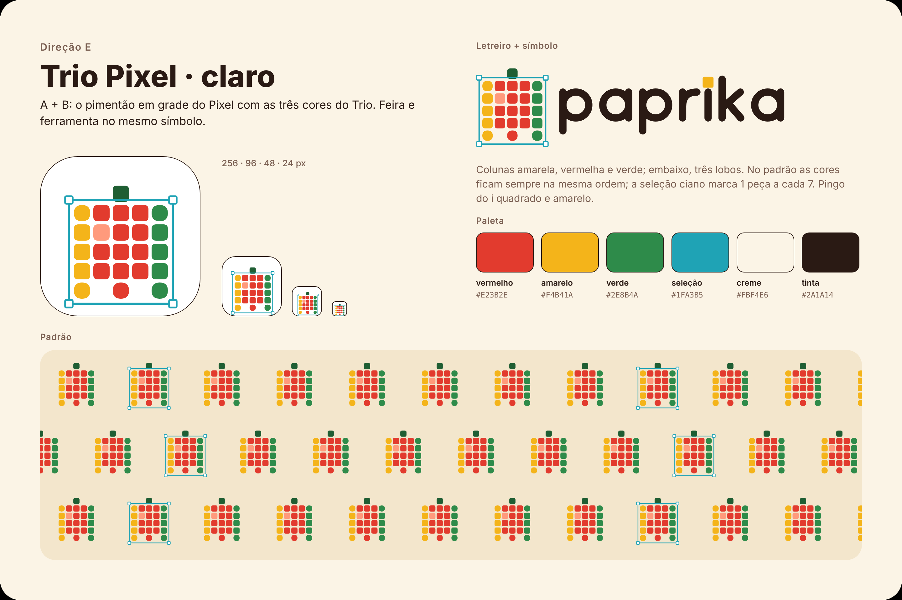
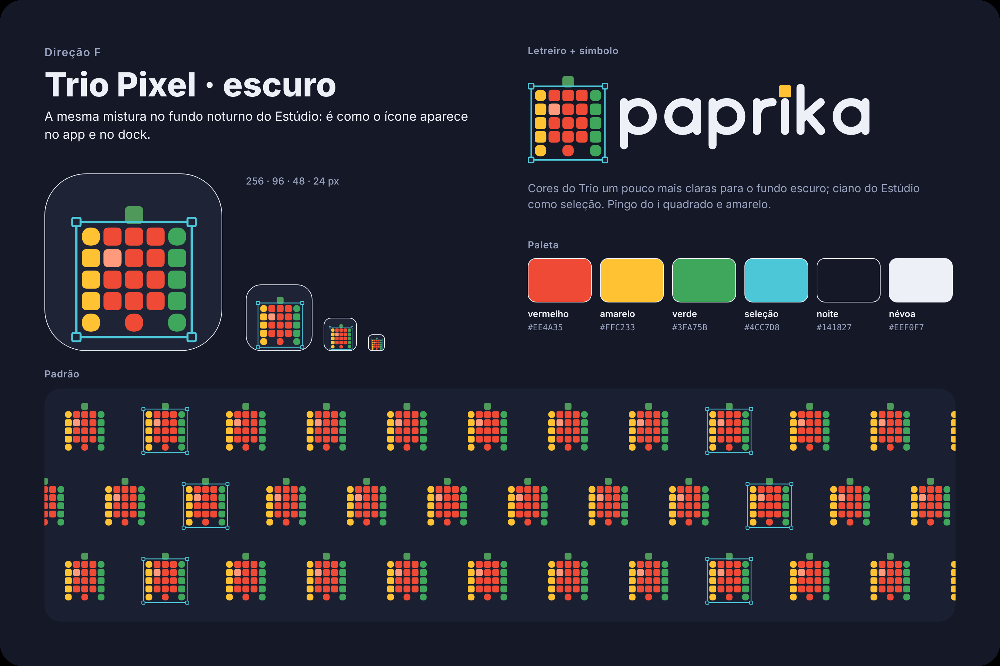

# Paprika brand · Trio Pixel

[Português](../../pt-BR/marca.md)

Chosen on 2026-11-25 from six concept directions (boards in [`docs/en-US/assets/boards/brand-trio-pixel`](../assets/boards/brand-trio-pixel)). It mixes **Trio** (the red, yellow and green peppers) with **Pixel** (the pepper as the canvas sees it: a grid, already selected).

| Light | Dark |
|---|---|
|  |  |

## Symbol

A 5×6 grid of rounded cells: yellow column on the left, red in the middle, green on the right, one highlight cell, a dark-green stem, and three lobes at the bottom (one per color). The cyan selection frame with four handles is part of the symbol at 32 px and up; below that use `favicon.svg`, which drops it.

## Wordmark

`paprika` in monoline geometric lowercase drawn as paths (no font dependency): round caps, x-height 100, stroke 24. The dot of the i is a yellow rounded square (corner radius a third of its side), the same shape as a selection handle, raised clear of the stem.

## Palette

| Role | Light | Dark |
|---|---|---|
| red | `#E23B2E` | `#EE4A35` |
| yellow | `#F4B41A` | `#FFC233` |
| green | `#2E8B4A` | `#3FA75B` |
| stem | `#1F5E33` | `#4F9A5A` |
| selection | `#1FA3B5` | `#4CC7D8` |
| background | `#FBF4E6` | `#141827` |
| tile | `#FFFFFF` | `#1E2336` |
| ink | `#2A1A14` | `#EEF0F7` |

The dark selection cyan and background are the app's current "Estúdio noturno" tokens, so the UI theme does not change with this brand. Applying the light palette to the app is part of the interface redesign, not of this change.

## Files

| File | Use |
|---|---|
| `icon.svg` / `icon-light.svg` | App icon, README, 32 px and up |
| `favicon.svg` | Favicon and the 22 px header logo (app and site) |
| `wordmark.svg` / `wordmark-light.svg` | Wordmark alone |
| `lockup.svg` / `lockup-light.svg` | Symbol + wordmark |

All of them come from one geometry, [`scripts/brand/trio-pixel.mjs`](../../../scripts/brand/trio-pixel.mjs). Regenerate with `node scripts/brand/trio-pixel-svg.mjs` (it also copies `favicon.svg` to `apps/web/public/icon.svg`). The boards are drawn in Paprika by [`scripts/brand/draw-concepts.mjs`](../../../scripts/brand/draw-concepts.mjs). `proposta-*.png` are the earlier proposals.
