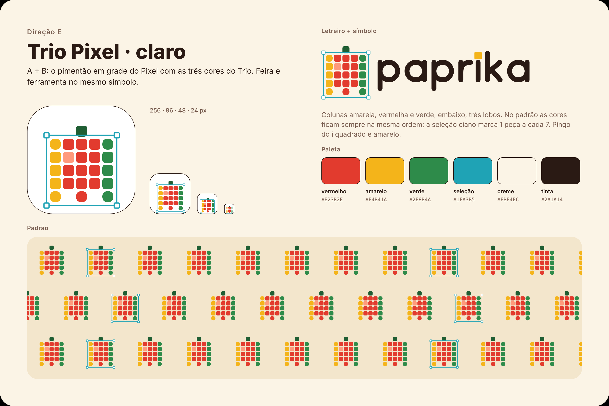
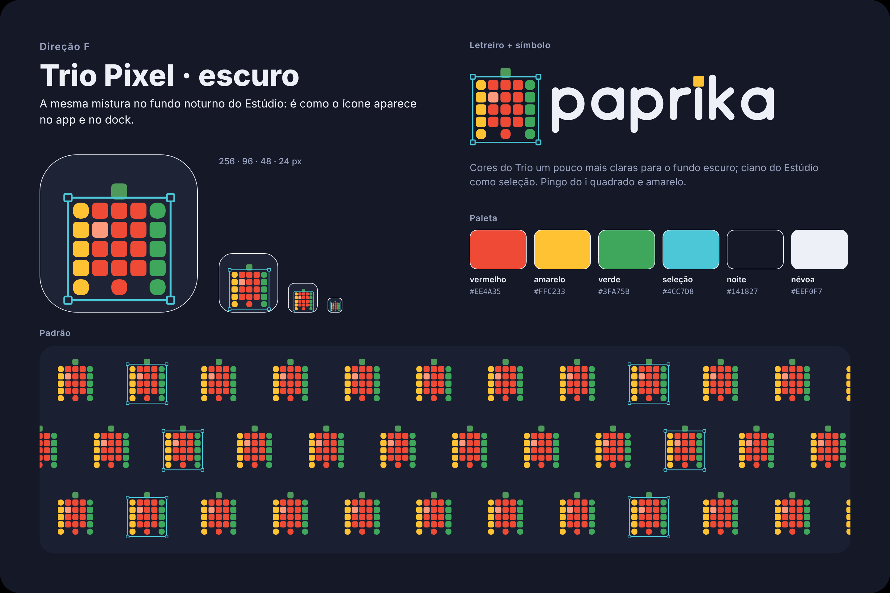

# Marca do Paprika · Trio Pixel

[English](../en-US/brand/README.md)

Escolhida em 2026-11-25 entre seis direções de conceito (boards em [`docs/en-US/assets/boards/brand-trio-pixel`](../en-US/assets/boards/brand-trio-pixel)). Mistura o **Trio** (os pimentões vermelho, amarelo e verde) com o **Pixel** (o pimentão como o canvas vê: uma grade, já selecionada).

| Claro | Escuro |
|---|---|
|  |  |

## Símbolo

Grade 5×6 de células arredondadas: coluna amarela à esquerda, vermelha no meio, verde à direita, uma célula de brilho, cabo verde-escuro e três lobos embaixo (um de cada cor). A moldura de seleção ciano com quatro alças faz parte do símbolo a partir de 32 px; abaixo disso, use `favicon.svg`, que tira a moldura.

## Letreiro

`paprika` em minúsculas geométricas monolineares desenhadas como paths (sem depender de fonte): pontas redondas, altura-x 100, traço 24. O pingo do i é um quadrado amarelo arredondado (raio de um terço do lado), no formato de uma alça de seleção, afastado da haste.

## Paleta

| Papel | Claro | Escuro |
|---|---|---|
| vermelho | `#E23B2E` | `#EE4A35` |
| amarelo | `#F4B41A` | `#FFC233` |
| verde | `#2E8B4A` | `#3FA75B` |
| cabo | `#1F5E33` | `#4F9A5A` |
| seleção | `#1FA3B5` | `#4CC7D8` |
| fundo | `#FBF4E6` | `#141827` |
| ladrilho | `#FFFFFF` | `#1E2336` |
| tinta | `#2A1A14` | `#EEF0F7` |

O ciano de seleção e o fundo do escuro são os tokens atuais do app ("Estúdio noturno"), então o tema da interface não muda com esta marca. Levar a paleta clara para o app faz parte do redesenho da interface, não desta mudança.

## Arquivos

| Arquivo | Uso |
|---|---|
| `icon.svg` / `icon-light.svg` | Ícone do app, README, de 32 px para cima |
| `favicon.svg` | Favicon e o logo de 22 px no cabeçalho (app e site) |
| `wordmark.svg` / `wordmark-light.svg` | Só o letreiro |
| `lockup.svg` / `lockup-light.svg` | Símbolo + letreiro |

Todos saem de uma geometria só, [`scripts/brand/trio-pixel.mjs`](../../scripts/brand/trio-pixel.mjs). Para regerar: `node scripts/brand/trio-pixel-svg.mjs` (também copia `favicon.svg` para `apps/web/public/icon.svg`). Os boards são desenhados no Paprika por [`scripts/brand/draw-concepts.mjs`](../../scripts/brand/draw-concepts.mjs). `proposta-*.png` são as propostas anteriores.
